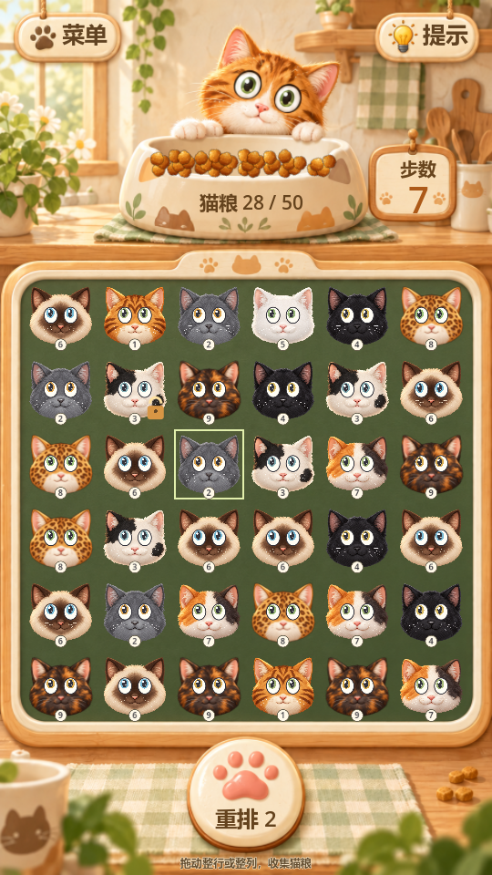

# 猫猫消除 / Chuzzle 原型

当前开发版本是 **Godot v9「奶油猫咪厨房」**。使用 Godot 4.7.2 打开 [project.godot](outputs/chuzzle-cats-godot/project.godot)，按 F5 运行。

- [项目上下文与决策](CONTEXT.md)：先读这个，再继续开发。
- [Godot 运行、规则与关卡编辑](outputs/chuzzle-cats-godot/README.md)；[设计检查](outputs/chuzzle-cats-godot/design-qa.md)。
- [早期 H5](outputs/index.html)：双击浏览器打开，无需依赖；功能和界面停留在早期，不代表最新 Godot。
- [玩偶猫动画样片](outputs/plush-cat-study/README.md)：独立 Godot 工程，尚未接入游戏。
- [Chuzzle 2 难度研究](outputs/Chuzzle2关卡难度解析.md)；[早期 H5 关卡原理](outputs/关卡制作说明.md)。
- [本次归档验证](docs/VALIDATION.md)；[源文件校验清单](docs/source-manifest.json)。

## 目录与验证

保留 outputs/ 层级以兼容原有截图和测试工具。运行时资源全部位于各自 Godot 工程中；.godot/ 由编辑器重新生成。旧版本 ZIP、原 APK/XAPK、反编译工作目录和生成缓存未归档。

先用 Godot 导入，再运行现有测试（在本目录执行，将 godot 替换为本机可执行文件）：

    godot --headless --editor --path outputs/chuzzle-cats-godot --import
    godot --headless --path outputs/chuzzle-cats-godot --script res://tests/test_rules.gd
    godot --headless --path outputs/chuzzle-cats-godot --script res://tests/test_drag.gd
    godot --headless --path outputs/chuzzle-cats-godot --script res://tests/test_refill.gd
    godot --headless --path outputs/chuzzle-cats-godot --script res://tests/test_hud.gd
    godot --headless --path outputs/chuzzle-cats-godot --script res://tests/test_gaze.gd

真实渲染截图使用 tests/capture_kitchen.gd，不加 --headless。tests/compare_kitchen.gd 读取一并保存的风格稿和截图，输出到本目录下 work/，运行前需创建该目录。历史截图脚本可能写入 outputs/ 或 work/；不要把新生成的逐帧截图全部提交。

源工程自带 README 的旧版本段落及统计属于历史记录；当前入口和状态以本页、CONTEXT.md 和实际 .tres 资源为准。
